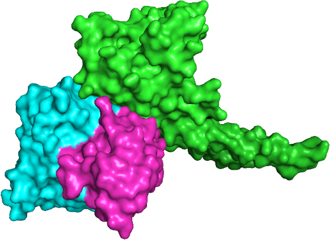

# HSS-PPI

<p align="center"></p>

Code and data for the paper:

> Quadrini M, Daberdaku S, Ferrari C. **Hierarchical representation for PPI sites prediction.** *BMC Bioinformatics* 23, 96 (2022). https://doi.org/10.1186/s12859-022-04624-y

HSS-PPI trains a graph convolutional network that predicts which residues of a protein are part of a protein–protein interaction interface. Each protein is a graph whose nodes are residues, built from one of three representations: the amino acid sequence, the contact map, or the hierarchical representation described in the paper.

The repository was first published at https://gitlab.com/sebastiandaberdaku/hss-ppi, the address given in the paper. This copy has the same code and data, with a pinned Python environment. The dataset and the original Singularity image are [release assets](https://github.com/sdaberdaku/hss-ppi/releases/tag/v1.0.0) instead of files in the repository.

## Contents

- `train.py`: loads a protein class, trains the model and evaluates it on the test set.
- `utils/`: data loading, the GCN model and layers, metrics and the command-line options (`config.py`).
- `preprocessing/`: scripts that computed the features in `data/` from the PDB structures.
- `entropy_analysis.py`: von Neumann graph entropy of the protein graphs.
- `exploration/`: the first experiments from early 2020 (AAindex feature selection, residue graphs on Docking Benchmark 5).
- `data/`: residue feature tables (`AAIndexFeatures.csv`, `aaindex1`, `one_hot_encoding.csv`, `selected_features_*.txt`).

## Data

The structures and features used in the paper are in the release asset `hss-ppi-data.tar.gz` (874 MB, about 1.1 GB extracted). Download and extract it from the repository root:

```bash
curl -L https://github.com/sdaberdaku/hss-ppi/releases/download/v1.0.0/hss-ppi-data.tar.gz | tar -xz
```

It adds to `data/`:

- `benchmark5/`: the Docking Benchmark 5 structures (see `data/benchmark5/README`).
- `train/`, `validation/`, `test/`: one folder per protein class (`A`, `AB`, `EI`, `ER`, `ES`, `OG`, `OR`, `OX`), each with the PDB files and the computed features: interface residues, distance and sequence matrices, ASA, relative ASA, phi/psi angles and residue contacts.

The SHA-256 checksums of the assets are in `SHA256SUMS` on the release page.

## Environment

The code needs Python 3.6 and TensorFlow 2.0. There are three ways to get the environment.

1. A virtual environment with the pinned packages:

   ```bash
   python3.6 -m venv .venv
   . .venv/bin/activate
   pip install -r requirements.txt
   ```

2. An Apptainer (or Singularity) image built from the definition file:

   ```bash
   apptainer build hss-ppi.sif hss-ppi.def
   ```

3. The image used for the paper (Ubuntu 18.04, Python 3.6, TensorFlow 2.0.0), `hss-ppi.sif`, from the [releases page](https://github.com/sdaberdaku/hss-ppi/releases).

With an image, prefix the commands below with `apptainer exec hss-ppi.sif` (or `singularity exec hss-ppi.sif`).

## Training

Run from the repository root. The class is chosen with `--protein_class`, the structure set with two flags:

| Structures | Command |
| --- | --- |
| Bound receptors | `python3 train.py --protein_class A --is_bound --is_receptor` |
| Bound ligands | `python3 train.py --protein_class A --is_bound` |
| Unbound receptors | `python3 train.py --protein_class A --is_receptor` |
| Unbound ligands | `python3 train.py --protein_class A` |

Options:

| Option | Default | Meaning |
| --- | --- | --- |
| `--representation_type` | `hierarchical` | `sequence`, `contact_map` or `hierarchical` |
| `--distance_threshold` | `12` | Cα–Cα distance (Å) under which two residues are connected |
| `--epochs` | `500` | Training epochs |
| `--learning_rate` | `0.001` | Learning rate |
| `--dropout` | `0.5` | Dropout rate |
| `--weight_decay` | `5e-4` | Weight decay |
| `--hidden` | `35 32` | Units per hidden layer |
| `--load_pickle` | off | Reuse the dataset saved by a previous run |

The first run for a class and structure set saves the loaded dataset to `data/<class>_<l|r>_<u|b>.pkl.gz`; `--load_pickle` reads it back, which is much faster.

Results go to a folder named after the settings, for example `results(epochs=500,representation_type=hierarchical,distance_threshold=12)/`. It contains the metrics (`<class>_<l|r>_<u|b>_interface_prediction.txt`), ROC and precision-recall plots, and the per-protein predictions in `predictions/test/<class>/`.

Examples:

```bash
# bound receptors of class A, contact map, 6 Å, 1390 epochs
python3 train.py --protein_class A --is_bound --is_receptor --epochs 1390 --distance_threshold 6 --representation_type contact_map

# bound ligands of class AB, contact map, 8 Å, 805 epochs
python3 train.py --protein_class AB --is_bound --epochs 805 --distance_threshold 8 --representation_type contact_map

# unbound receptors of class EI, hierarchical, 8 Å, 835 epochs
python3 train.py --protein_class EI --is_receptor --representation_type hierarchical --distance_threshold 8 --epochs 835

# unbound ligands of class AB, hierarchical, 10 Å, 580 epochs
python3 train.py --protein_class AB --epochs 580 --distance_threshold 10 --representation_type hierarchical
```

`interface_prediction_slurm.job` runs `train.py` with the image on a SLURM cluster. Submit it from the repository root and pass the options after the script name, for example `sbatch interface_prediction_slurm.job --protein_class A --is_bound`.

## Preprocessing

The features in `data/` are already computed. To recompute them from the PDB files in `data/<partition>/<class>/pdb/`, run these scripts from the repository root:

| Script | Output folder |
| --- | --- |
| `preprocessing/determine_interface.py` | `interaction_interface/` |
| `preprocessing/aa_distance_matrix.py` | `distance_matrices/` (slow; uses all cores) |
| `preprocessing/aa_sequence_matrix.py` | `sequence_matrices/` |
| `preprocessing/ASA.py` | `ASA/` |
| `preprocessing/relative_ASA.py` | `relative_ASA/` |
| `preprocessing/PHI-PSI.py` | `PHI/`, `PSI/` |
| `preprocessing/residue_contacts.py` | `residue_contacts_<threshold>/` |

For example: `python3 preprocessing/ASA.py`.

## Citation

```bibtex
@article{quadrini2022hierarchical,
  title   = {Hierarchical representation for PPI sites prediction},
  author  = {Quadrini, Michela and Daberdaku, Sebastian and Ferrari, Carlo},
  journal = {BMC Bioinformatics},
  volume  = {23},
  number  = {1},
  pages   = {96},
  year    = {2022},
  doi     = {10.1186/s12859-022-04624-y}
}
```

## License

MIT, see [LICENSE](LICENSE).
